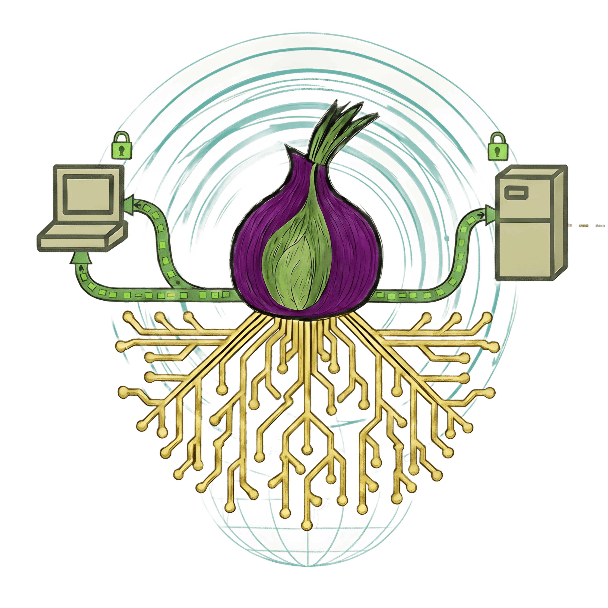

<div align="center">



# 🧅 Tor AIO Stack

**Complete Bridge, Relay & Exit Node Solution**

[](https://github.com/r3bo0tbx1/tor-guard-relay/releases/latest)
[](https://hub.docker.com/r/r3bo0tbx1/onion-relay)
[](https://github.com/r3bo0tbx1/tor-guard-relay)

**Hardened · Lightweight · Observable**

[📚 Documentation](https://github.com/r3bo0tbx1/tor-guard-relay#-documentation) · [🌐 Live Dashboard](https://relays.brokenbotnet.com/) · [💜 Support](https://brokenbotnet.com/donate/)

</div>

---

## 🆕 v2.2.1: Tor directory-request DoS defenses

Current release: <!-- RELAY_VERSION -->v2.2.1<!-- /RELAY_VERSION -->. Original stable and edge images shipped **Tor 0.4.9.15**, built from authenticated upstream source for **AMD64 and ARM64**. Current source builds use the [reviewed Tor pin](https://github.com/r3bo0tbx1/tor-guard-relay/blob/main/build/tor/source.json) for the next validated rebuild of the same image tags. Check the selected publication's evidence, recreate the container and verify the running Tor binary.

Tor 0.4.9.16 is an [authority-focused emergency update](https://forum.torproject.org/t/security-release-0-4-9-16/22372); upstream recommends upgrading but reports no urgency for operators who do not run a directory authority. No new mandatory torrc lines are introduced. See the [current migration guidance](https://github.com/r3bo0tbx1/tor-guard-relay/blob/main/docs/MIGRATION.md#-reviewed-tor-source-updates).

| Feature | What it gives you |
| --- | --- |
| 🛡️ Reviewed Tor source | Directory-request DoS defenses and a shared source/acceptance pin for both variants |
| 🏗️ Authenticated Tor builds | Verified upstream source packaged as an APK for the matching Alpine base |
| 🔎 Current-run diagnostics | Health, readiness, `doctor` and redacted config checks |
| ⚙️ Validated configuration | Atomic changes and reloads that preserve the Tor process |
| 🔐 Encrypted recovery | Verified backups of config, identity keys and relay state; staged offline restore |
| 📊 Fleet inventory | Host-side inventory and metrics without an exposed diagnostics port |
| ✅ Verified publication | Both architectures checked before their exact images reach the registries |

📖 [v2.2.1 release notes](https://github.com/r3bo0tbx1/tor-guard-relay/releases/tag/v2.2.1) · [Migration guide](https://github.com/r3bo0tbx1/tor-guard-relay/blob/v2.2.1/docs/MIGRATION.md)

**📝 torrc:** No new mandatory lines are required. Leave `DoSBeginDirRateEnabled`, `DoSBeginDirRate`, `DoSBeginDirBurst` and `DoSBeginDirDefenseType` unset so the network consensus controls them. After upgrading, review any temporary `DirCache 0` workaround. Keep `DirPort 0` if it is part of your deployment. See the [sample configurations](https://github.com/r3bo0tbx1/tor-guard-relay/tree/v2.2.1/examples) and [operator guidance](https://github.com/r3bo0tbx1/tor-guard-relay/blob/v2.2.1/docs/releases/v2.2.1.md#-what-to-change-in-torrc).

## 🏷️ Choose your image

| Docker Hub tag | Variant | Platforms |
| --- | --- | --- |
| `latest` | Stable, recommended for production | AMD64 / ARM64 |
| <!-- RELAY_IMAGE_VERSION -->`2.2.1`<!-- /RELAY_IMAGE_VERSION --> | Stable version series | AMD64 / ARM64 |
| `edge` | Alpine edge, for testing | AMD64 / ARM64 |

Stable uses **Alpine 3.24.4**. Validated manual and scheduled rebuilds from main include merged fixes and fresh packages; version tags can receive those rebuilds. Pin an image digest when you need an exact build.

Retired container tags can be removed while [historical GitHub releases and their SBOM/security assets](https://github.com/r3bo0tbx1/tor-guard-relay/releases) remain available. Keep a verified current image digest for rollback.

🛡️ [Registry retention](https://github.com/r3bo0tbx1/tor-guard-relay/blob/main/docs/REGISTRY-RETENTION.md) previews superseded rebuilds while preserving current image indexes and their untagged AMD64/ARM64 children, original-release images and reviewed deployment/rollback digests. Weekly previews continue; automatic cleanup waits 14 days after the published notice and runs at most every 14 days with fresh deployment protection and an unchanged plan.

```bash
docker pull r3bo0tbx1/onion-relay:latest
docker pull r3bo0tbx1/onion-relay:2.2.1
docker pull r3bo0tbx1/onion-relay:edge
```

📦 GHCR additionally provides versioned edge tags, including `ghcr.io/r3bo0tbx1/onion-relay:2.2.1-edge`.

## 🚀 Deploy with your own relay configuration

Use the [deployment guide](https://github.com/r3bo0tbx1/tor-guard-relay/blob/main/docs/DEPLOYMENT.md) for Docker CLI, Compose, Portainer or Cosmos Cloud. Set your relay nickname, contact, mode and bandwidth before starting a public relay.

> 🔐 Before upgrading, verify an encrypted backup and compare relay fingerprints. Recovery tooling requires host Python 3.10+ and age. Keep persistent changes in deployment ENV or a mounted torrc; generated torrc is recreated on restart. Never activate two copies of the same relay identity.

[🔐 Backup and recovery](https://github.com/r3bo0tbx1/tor-guard-relay/blob/main/docs/BACKUP.md) · [🧰 Operator tools](https://github.com/r3bo0tbx1/tor-guard-relay/blob/main/docs/TOOLS.md) · [🛡️ Security policy](https://github.com/r3bo0tbx1/tor-guard-relay/blob/main/SECURITY.md)
